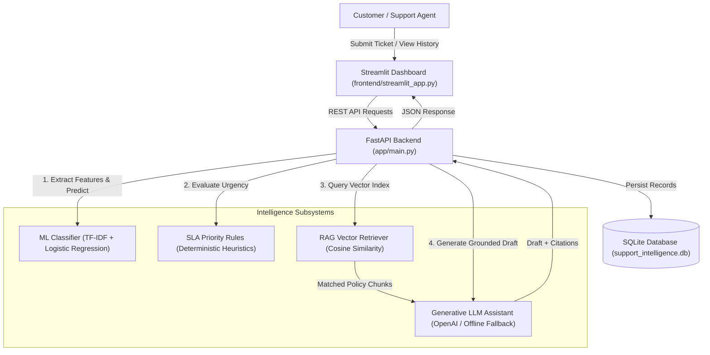

# AI Support Intelligence Platform — Intelligent Ticket Classification and RAG Assistant

[](https://www.python.org/)
[](https://fastapi.tiangolo.com/)
[](https://scikit-learn.org/)
[](https://streamlit.io/)
[](https://pytest.org/)
[](LICENSE)

An end-to-end, production-grade AI support operations platform that automates incoming customer ticket triage. Combines fast classical **Machine Learning (Scikit-Learn)** for ticket classification, transparent **SLA Priority Heuristics**, and **Retrieval-Augmented Generation (RAG)** to draft accurate, policy-grounded support replies with source citations.

> 🖥️ **Live Web Dashboard:** [https://ai-support-intelligence-platform.streamlit.app/](https://ai-support-intelligence-platform.streamlit.app/)  
> 🌐 **Live Cloud API:** [https://ai-support-intelligence-platform-1.onrender.com](https://ai-support-intelligence-platform-1.onrender.com)  
> 📑 **Interactive Swagger UI:** [https://ai-support-intelligence-platform-1.onrender.com/docs](https://ai-support-intelligence-platform-1.onrender.com/docs)  
> 🩺 **Live Health Check:** [https://ai-support-intelligence-platform-1.onrender.com/health](https://ai-support-intelligence-platform-1.onrender.com/health)  
> 📊 **Live Model Metrics:** [https://ai-support-intelligence-platform-1.onrender.com/metrics](https://ai-support-intelligence-platform-1.onrender.com/metrics)

---

## 1. Project Overview

In modern SaaS companies, customer support teams receive hundreds of unstructured inquiries daily. Manual triage is slow, prone to human error, and expensive. 

This platform acts as an **AI Copilot for Support Engineers**:
1. **Categorizes incoming tickets** automatically using a trained machine learning text classifier (`Billing`, `Technical Issue`, `Account Access`, `General Inquiry`).
2. **Evaluates urgency and SLA impact** using transparent, explainable heuristic rules.
3. **Retrieves relevant knowledge-base policies** using vector similarity search.
4. **Drafts grounded responses** using an LLM (with prompt injection guardrails and a guaranteed offline fallback mode).
5. **Enables human review and override** before sending responses to customers.

---

## 2. Business Problem Being Solved

- **Slow Response Times:** Manual triage takes 10 to 45 minutes per ticket, risking SLA breaches.
- **Inconsistent Categorization:** Different agents classify the same incident under different queues.
- **LLM Hallucinations:** Using generative AI without grounding leads to fabricated refund guarantees or invalid technical advice.
- **Expensive LLM Token Usage:** Calling massive LLMs just to classify simple text burns cloud budgets unnecessarily. Classical ML solves this in milliseconds for \$0.

---

## 3. Main Features

- ⚡ **Sub-5ms ML Classification:** Pre-trained TF-IDF + Logistic Regression pipeline with calibrated probability distribution.
- 🎯 **Explainable Priority Engine:** Transparent SLA rules detect outages, security lockouts, and payment failures with audit reasons.
- 🔍 **RAG Knowledge Retrieval:** In-memory vector search over chunked markdown documentation using Cosine Similarity.
- 🛡️ **Defensive Prompt Engineering:** Strict boundary enforcement separating untrusted customer input from trusted company policy.
- 🔄 **Resilient Dual-Mode LLM:** Works with live OpenAI API or a 100% reliable offline mock generator for guaranteed zero-cost demos.
- 💾 **Persistent SQLite Storage:** Complete audit trail of tickets, predictions, confidence scores, and citations.
- 💻 **4-Tab Streamlit Dashboard:** Ticket submission, human review & overrides, knowledge base explorer, and ML model performance metrics.
- 🧪 **Comprehensive Automated Tests:** 21 automated pytest tests covering unit, service, and API integration workflows.

---

## 4. System Architecture Diagram



---

## 5. Technology Stack & Rationale

| Component | Technology | Why It Was Chosen |
| :--- | :--- | :--- |
| **Language** | Python 3.11 | Standard for AI/ML engineering, high performance, rich ecosystem. |
| **Backend** | FastAPI + Uvicorn | Async ASGI server, high throughput, automatic Pydantic validation, interactive OpenAPI Swagger docs. |
| **Machine Learning** | Scikit-learn | Fast, robust classical text classification (TF-IDF + Logistic Regression) without GPU overhead. |
| **Data Processing** | Pandas & NumPy | Vector operations, dataset manipulation, and confusion matrix computation. |
| **RAG & Retrieval** | Cosine Similarity | Lightweight, deterministic vector search without requiring heavy external vector DB clusters. |
| **Generative AI** | Prompt Engineering + LLM | Structured prompts with system grounding; supports OpenAI API and offline mock fallback. |
| **Database** | SQLite | Zero-configuration, file-based relational persistence with standard Python `sqlite3`. |
| **Frontend** | Streamlit | Rapid interactive prototyping, rich dataframes, native charts, and responsive UI. |
| **Testing** | Pytest | Industry-standard test runner with fixtures and assertion introspection. |
| **Deployment** | Docker & Render | Reproducible containerization and one-click cloud deployment. |

---

## 6. End-to-End Workflows

### Ticket Processing Workflow
1. User enters title and description in Streamlit UI.
2. `POST /tickets` saves ticket to SQLite in `open` status.
3. `POST /tickets/{id}/analyze` triggers ML classification, SLA priority heuristics, and vector search.
4. `POST /tickets/{id}/draft-response` invokes the LLM with grounded citations and transitions ticket to `analyzed`.
5. Human agent inspects confidence distribution, reviews citations, and can override categories or approve drafts.

### RAG Knowledge Base Workflow
```text
Markdown Documents (data/knowledge_base/)
               │
               ▼
   [Section-Based Chunking] (app/services/document_ingestion.py)
               │
               ▼
   [TF-IDF N-Gram Vectorizer] (app/services/retriever.py)
               │
   Incoming Query Vector ──► [Cosine Similarity Matching]
                                       │
                                       ▼
                   Top-K Passages Filtered by Threshold
                                       │
                                       ▼
               Injected into System-Grounded Prompt Template
```

---

## 7. Machine Learning Training & Evaluation Results

The text classification model was trained and evaluated on `data/sample_tickets.csv` using a **75/25 stratified train/test split** (preventing data leakage).

- **Total Dataset:** 64 tickets (16 per category)
- **Training Samples:** 48
- **Test Samples:** 16 (unseen)
- **Overall Test Accuracy:** **81.25% (0.8125)**

### Classification Report:
| Category | Precision | Recall | F1-Score | Support |
| :--- | :---: | :---: | :---: | :---: |
| **Account Access** | 0.80 | 1.00 | 0.89 | 4 |
| **Billing** | 0.67 | 1.00 | 0.80 | 4 |
| **General Inquiry** | 1.00 | 0.50 | 0.67 | 4 |
| **Technical Issue** | 1.00 | 0.75 | 0.86 | 4 |
| **Weighted Average** | **0.87** | **0.81** | **0.80** | 16 |

### Confusion Matrix:
```text
Labels: [Account Access, Billing, General Inquiry, Technical Issue]

Actual \ Pred       AccAccess  Billing  GenInq  TechIssue
Account Access          4         0        0        0
Billing                 0         4        0        0
General Inquiry         0         2        2        0
Technical Issue         1         0        0        3
```

---

## 8. Project Directory Structure

```text
Project1/
├── .env.example               # Template for environment variables
├── .gitignore                 # Excludes .env, *.db, __pycache__, and venvs
├── Dockerfile                 # Container specification for cloud deployment
├── render.yaml                # One-click Render deployment blueprint
├── requirements.txt           # Python dependency manifest
├── README.md                  # This documentation
├── TROUBLESHOOTING.md         # Windows and deployment troubleshooting guide
├── FINAL_STATUS.md            # Acceptance checklist and readiness report
├── app/
│   ├── __init__.py
│   ├── config.py              # Environment configuration loader
│   ├── database.py            # SQLite schema initialization and connection
│   ├── main.py                # FastAPI app entry point and CORS setup
│   ├── schemas.py             # Pydantic request and response schemas
│   ├── routes/
│   │   ├── tickets.py         # Ticket CRUD, analysis, and drafting endpoints
│   │   └── knowledge.py       # RAG search and indexing endpoints
│   └── services/
│       ├── classifier.py      # Scikit-learn inference service
│       ├── priority.py        # Transparent SLA priority heuristic engine
│       ├── document_ingestion.py # Markdown document parser and chunker
│       ├── retriever.py       # Vector similarity retrieval engine
│       ├── prompt_templates.py# Grounded system prompts and guardrails
│       └── llm_service.py     # LLM generator with resilient offline fallback
├── data/
│   ├── sample_tickets.csv     # 64-sample stratified training dataset
│   └── knowledge_base/        # Policy markdown documents
│       ├── billing_policy.md
│       ├── account_security.md
│       ├── technical_troubleshooting.md
│       └── general_sla_faq.md
├── frontend/
│   └── streamlit_app.py       # 4-tab interactive Streamlit web dashboard
├── models/
│   ├── classifier.joblib      # Serialized Scikit-learn model artifact
│   └── metrics.json           # Empirical evaluation metrics and confusion matrix
├── scripts/
│   ├── generate_dataset.py    # Generates balanced dataset
│   └── train_model.py         # Model training and evaluation pipeline
├── tests/
│   ├── test_api.py            # API endpoint integration tests
│   ├── test_classifier.py     # ML classifier unit tests
│   ├── test_priority.py       # Priority engine unit tests
│   ├── test_retriever.py      # RAG vector retrieval tests
│   └── test_llm.py            # LLM grounding and fallback tests
└── docs/
    ├── PROJECT_EXPLANATION.md # Deep technical walkthrough of every module
    ├── TESTING_GUIDE.md       # Pytest results and user journeys
    ├── GITHUB_GUIDE.md        # Step-by-step Git commands and publishing
    ├── DEPLOYMENT_GUIDE.md    # Cloud deployment on Render & Streamlit
    ├── DEPLOYMENT_VERIFICATION.md # Live verification checklist
    └── INTERVIEW_PREPARATION.md # 30 technical Q&As and demo scripts
```

---

## 9. Quickstart: Run Locally on Windows in 5 Minutes

### Step 1: Open Terminal in Project Directory
Open VS Code in `C:\Users\Madhavi\Downloads\Project1`.

### Step 2: Configure Environment Variables
Copy `.env.example` to `.env`:
```powershell
Copy-Item .env.example .env
```
*(By default, `LLM_PROVIDER=mock`, meaning the entire platform runs 100% offline with zero external dependencies and zero costs).*

### Step 3: Run Automated Tests
Verify that all 21 tests pass:
```powershell
pytest -v
```

### Step 4: Start the FastAPI Backend (Terminal 1)
```powershell
python -m uvicorn app.main:app --host 127.0.0.1 --port 8000 --reload
```
Open your browser to:
- Health check: `http://127.0.0.1:8000/health`
- Interactive Swagger docs: `http://127.0.0.1:8000/docs`

### Step 5: Start the Streamlit Frontend (Terminal 2)
Open a second terminal in VS Code:
```powershell
streamlit run frontend/streamlit_app.py
```
Your browser will open automatically to `http://localhost:8501`.

---

## 10. API Endpoint Reference

| Method | Endpoint | Description | Sample Request | Sample Response |
| :--- | :--- | :--- | :--- | :--- |
| `GET` | `/health` | System health & model status | *None* | `{"status": "healthy", "classifier_ready": true}` |
| `POST` | `/tickets` | Create a new support ticket | `{"title": "...", "description": "..."}` | `{"id": 1, "ticket_code": "TCK-1001", "status": "open"}` |
| `GET` | `/tickets` | List all tickets | *Optional `?status_filter=open`* | `[{"ticket_code": "TCK-1001", ...}]` |
| `GET` | `/tickets/{id}` | Get ticket details | *None* | `{"id": 1, "title": "...", ...}` |
| `POST` | `/tickets/{id}/analyze` | Run ML + Priority + RAG | *None* | `{"predicted_category": "Billing", "priority": "High"}` |
| `POST` | `/tickets/{id}/draft-response` | Generate grounded LLM draft | `{"custom_instructions": "..."}` | `{"draft_response": "...", "citations": [...]}` |
| `PATCH` | `/tickets/{id}` | Human review & override | `{"category": "Billing", "priority": "Urgent"}` | `{"id": 1, "priority": "Urgent"}` |
| `GET` | `/knowledge/search` | Vector search over policies | `?query=refund&top_k=3` | `[{"source": "billing_policy.md", "score": 0.17}]` |
| `GET` | `/metrics` | Measured ML evaluation metrics | *None* | `{"accuracy": 0.8125, "classes": [...]}` |

---

## 11. Retraining the ML Model

If you add new tickets to `data/sample_tickets.csv`, retrain the classifier in one command:
```powershell
python scripts/train_model.py
```
This updates `models/classifier.joblib` and `models/metrics.json` instantly.

---

## 12. Adding Documents to Knowledge Base

To expand company support policies:
1. Add a new `.md` file in `data/knowledge_base/` (e.g. `shipping_faq.md`).
2. Format sections with markdown headers: `## Section 1: Return Labels`.
3. In the UI or via API, call `POST /knowledge/reindex`. The vector index updates automatically without restarting the server!

---

## 13. Deployment

See full instructions in:
- [docs/DEPLOYMENT_GUIDE.md](docs/DEPLOYMENT_GUIDE.md)
- [docs/DEPLOYMENT_VERIFICATION.md](docs/DEPLOYMENT_VERIFICATION.md)

---

## 14. Security & Compliance

The platform follows rigorous security practices audited against the OWASP Top 10 for LLM Applications:
- **Zero Committed Secrets:** `.env` and `*.db` are strictly excluded from version control.
- **SQL Injection Prevention:** 100% parameterized queries across all SQLite interactions.
- **Input Validation:** Strict Pydantic boundary checks prevent resource exhaustion.
- **Prompt Injection Defense:** Strict delimitation between trusted knowledge base context and untrusted customer ticket text.
- **Hallucination Guardrails:** Similarity threshold gating prevents unsupported assertions.

See the full audit report: **[docs/SECURITY_AUDIT.md](docs/SECURITY_AUDIT.md)**.

---

## 15. License & Attribution

Developed as an AI Engineering portfolio demonstration. Distributed under the MIT License.
