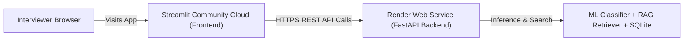

# Cloud Deployment Guide: Render & Streamlit Community Cloud

**AI Support Intelligence Platform**

This guide provides step-by-step instructions to deploy your application online for free so interviewers can test it live in their browsers.

---

## 1. Hosting Architecture Overview

We use a decoupled production architecture:
1. **FastAPI REST Backend:** Deployed on **Render** (free web service, Python 3.11 native, automatic health checks).
2. **Streamlit Web Dashboard:** Deployed on **Streamlit Community Cloud** (free, native Streamlit hosting with direct GitHub integration).



---

## 2. Step-by-Step Backend Deployment on Render

### Step 1: Sign In to Render
1. Visit [render.com](https://render.com) and click **Get Started** or **Sign In**.
2. Sign in with your **GitHub** account so Render can access your repository.

### Step 2: Create a New Web Service
1. In the Render Dashboard, click **New +** in the top right corner and select **Web Service**.
2. Select **Build and deploy from a Git repository**.
3. Locate your repository (`ai-support-intelligence-platform`) and click **Connect**.

### Step 3: Configure Build & Start Commands
Fill in the deployment settings:
- **Name:** `ai-support-intelligence-api` (or a name of your choice)
- **Region:** Frankfurt (EU Central) or Oregon (US West)
- **Branch:** `main`
- **Runtime:** `Python 3`
- **Build Command:**
  ```bash
  pip install -r requirements.txt && python scripts/train_model.py
  ```
- **Start Command:**
  ```bash
  uvicorn app.main:app --host 0.0.0.0 --port $PORT
  ```
- **Instance Type:** Select **Free**.

### Step 4: Configure Environment Variables
Scroll down to the **Environment Variables** section and click **Add Environment Variable**:
| Key | Value | Purpose |
| :--- | :--- | :--- |
| `PYTHON_VERSION` | `3.11.0` | Forces Python 3.11 runtime |
| `APP_ENV` | `production` | Production mode |
| `DEBUG` | `False` | Disables debug stack traces |
| `LLM_PROVIDER` | `mock` | Guaranteed free offline demo mode |
| `EMBEDDING_MODE` | `tfidf` | Lightweight vector retrieval |

*(If you have an OpenAI API key, set `LLM_PROVIDER=openai` and add `LLM_API_KEY=sk-...`)*

### Step 5: Deploy and Test
1. Click **Create Web Service**.
2. Wait 2–3 minutes for the build and model training to finish.
3. Once the dashboard shows a green **Live** status, copy your public service URL (e.g. `https://ai-support-intelligence-api.onrender.com`).
4. In your browser, open:
   `https://<your-render-url>/health`
   You should see:
   ```json
   {"status":"healthy","app_name":"AI Support Intelligence Platform","classifier_ready":true,"knowledge_base_chunks":20,"llm_provider":"mock"}
   ```
5. Open interactive API docs: `https://<your-render-url>/docs`.

---

## 3. Step-by-Step Frontend Deployment on Streamlit Cloud

### Step 1: Sign In to Streamlit Community Cloud
1. Go to [share.streamlit.io](https://share.streamlit.io).
2. Sign in using your **GitHub** account.

### Step 2: Deploy New App
1. Click **Create app** > select **I already have an app**.
2. Fill in the repository details:
   - **Repository:** `<your-username>/ai-support-intelligence-platform`
   - **Branch:** `main`
   - **Main file path:** `frontend/streamlit_app.py`
   - **App URL:** Customize if desired (e.g., `ai-support-intelligence.streamlit.app`).

### Step 3: Configure Environment Secrets
1. Before clicking deploy, click **Advanced settings...**.
2. In the **Secrets** box, enter your public Render backend URL:
   ```toml
   BACKEND_API_URL = "https://ai-support-intelligence-api.onrender.com"
   ```
3. Click **Save** and then click **Deploy!**.

### Step 4: Verify Live System
1. Your public Streamlit dashboard will launch in 1–2 minutes.
2. In the sidebar, look for `🟢 Backend Connected`.
3. Select a sample incident and click **Submit & Run AI Analysis**.
4. Confirm that category prediction, priority assessment, RAG passages, and the AI draft render cleanly.

---

## 4. Handling Render Free-Tier Cold Starts

> [!NOTE]
> On Render's free tier, inactive services "spin down" after 15 minutes of inactivity. The first request after a sleep period may take ~50 seconds to boot up. This is standard cloud behavior on free tiers. Before your interview, open the URL 2 minutes prior to your meeting so the service is warm and instantly responsive!
