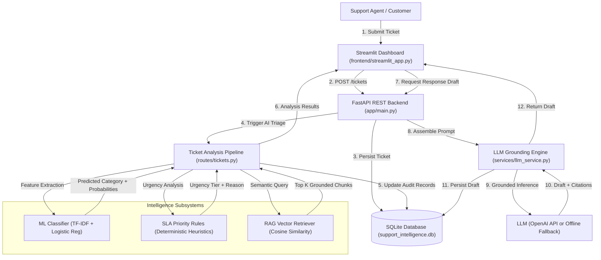

# Deep Technical Architecture & Project Explanation

**AI Support Intelligence Platform — Intelligent Ticket Classification and RAG Assistant**

This document provides a comprehensive, beginner-friendly technical explanation of the entire system architecture, every individual file, and core Artificial Intelligence concepts.

---

# Part A: The Big-Picture Architecture

In enterprise IT and SaaS customer service environments (e.g. Zendesk, Jira Service Desk, Salesforce Service Cloud), incoming support tickets must be triaged rapidly. Manual triage by human agents takes 10 to 45 minutes per ticket, leading to SLA breaches, high operational overhead, and human error.

Our platform automates this workflow with a hybrid AI architecture:

### What Happens at Each Stage:
1. **Submission:** The user inputs an issue title and description into the Streamlit UI.
2. **Persistence:** FastAPI receives the HTTP payload, generates a unique code (`TCK-1001`), and stores it in SQLite with status `open`.
3. **Machine Learning Classification:** The scikit-learn pipeline vectorizes the text using TF-IDF n-grams and executes Logistic Regression inference. It outputs the predicted category (`Billing`, `Technical Issue`, `Account Access`, or `General Inquiry`) and calibrated probability scores.
4. **Transparent Priority Triage:** A deterministic SLA engine scans for operational risk keywords (e.g. `outage`, `crash`, `unauthorized`, `locked`) and assigns an urgency tier (`Urgent`, `High`, `Medium`, `Low`) with human-readable audit reasons.
5. **RAG Vector Search:** The query is transformed into a vector space and compared against markdown knowledge chunks using Cosine Similarity. The top-scoring policy passages are extracted with source citations.
6. **Context-Grounded LLM Generation:** The system prompt isolates untrusted user text from trusted policy text. The LLM synthesizes an evidence-grounded response citing specific policy sections.
7. **Human-in-the-Loop:** Support agents inspect the predictions, view probability distributions, review citations, and can override categories or approve drafts before sending.

---

# Part B: File-by-File Breakdown

### 1. `app/config.py`
- **Purpose:** Centralized application configuration.
- **Why it exists:** Keeps settings, ports, paths, and API keys outside application code (Twelve-Factor App standard).
- **Key Imports:** `os`, `pathlib.Path`, `dotenv.load_dotenv`.
- **Key Variables:** `settings.APP_NAME`, `settings.DATABASE_PATH`, `settings.LLM_PROVIDER`, `settings.TOP_K_RETRIEVAL`.
- **Connections:** Imported by `database.py`, `retriever.py`, `classifier.py`, `llm_service.py`, and `main.py`.
- **Interview Question:** *Why did you resolve paths with `Path(__file__).resolve().parent.parent`?*  
  *Answer: To ensure filesystem paths resolve dynamically across local Windows dev, Docker containers, and Linux cloud hosts.*

---

### 2. `app/database.py`
- **Purpose:** SQLite persistence layer.
- **Why it exists:** Provides zero-dependency, lightweight relational storage for tickets, predictions, and audit logs.
- **Key Functions:**
  - `get_db_connection()`: Opens thread-safe connection with `sqlite3.Row` factory.
  - `init_db()`: Executes DDL statements to create the `tickets` table and indexes.
  - `row_to_dict()`: Converts rows to dicts and deserializes stored JSON citation strings.
- **Connections:** Called on startup in `app/main.py` and accessed by `app/routes/tickets.py`.

---

### 3. `app/schemas.py`
- **Purpose:** Pydantic models for request validation and response serialization.
- **Why it exists:** Enforces data contracts, prevents malformed requests, and auto-generates Swagger schemas.
- **Key Classes:** `TicketCreate`, `TicketResponse`, `Citation`, `TicketAnalysisResult`, `DraftResponseResult`.
- **Connections:** Imported by FastAPI routers and unit tests.

---

### 4. `scripts/train_model.py`
- **Purpose:** Trains, evaluates, and serializes the text classifier.
- **Why it exists:** Machine learning models must be trained offline and saved as artifacts so inference is instantaneous.
- **Key Classes & Methods:**
  - `TfidfVectorizer(ngram_range=(1,2), sublinear_tf=True)`: Feature extraction.
  - `LogisticRegression(C=5.0)`: Calibrated linear classification.
  - `train_test_split(..., stratify=y)`: Preserves class distribution and prevents data leakage.
  - `joblib.dump()`: Serializes model artifact to `models/classifier.joblib`.
- **Connections:** Produces `models/classifier.joblib` and `models/metrics.json` read by `app/services/classifier.py` and `/metrics`.

---

### 5. `app/services/classifier.py`
- **Purpose:** Fast real-time inference service.
- **Why it exists:** Decouples model inference from web route handlers; loads model once into memory (Singleton).
- **Key Methods:** `predict(title, description)` -> returns predicted category, confidence score, and probability dictionary.
- **Connections:** Injected into `app/routes/tickets.py` via `get_classifier()`.

---

### 6. `app/services/priority.py`
- **Purpose:** Transparent, explainable SLA priority heuristics.
- **Why it exists:** Prevents deceptive claims about "deep learning priority" when deterministic business rules are actually used.
- **Key Rules:** Outage/crash -> `Urgent`; Account lockout/payment failure -> `High`; General inquiry -> `Low`.
- **Connections:** Called during ticket analysis in `app/routes/tickets.py`.

---

### 7. `app/services/document_ingestion.py`
- **Purpose:** Ingests and chunks markdown support documents.
- **Why it exists:** LLMs and vector search need small, focused passages rather than monolithic documents.
- **Key Logic:** Scans `data/knowledge_base/*.md`, splits text by section headers (`## Section`), preserves source metadata.
- **Connections:** Ingests chunks for `app/services/retriever.py`.

---

### 8. `app/services/retriever.py`
- **Purpose:** Vector similarity retrieval engine.
- **Why it exists:** Fetches exact policy evidence to ground LLM generation and eliminate hallucinations.
- **Key Logic:** Computes TF-IDF vectors for chunks, transforms incoming query, executes `cosine_similarity`, filters by threshold.
- **Connections:** Supplies citations to `app/routes/tickets.py` and `app/routes/knowledge.py`.

---

### 9. `app/services/llm_service.py` & `prompt_templates.py`
- **Purpose:** Generates grounded response drafts using retrieved citations.
- **Why it exists:** Produces contextual customer drafts with strict boundary guardrails against prompt injection.
- **Key Logic:** Supports OpenAI API and includes a grounded offline mock generator that works 100% reliably without paid API keys.
- **Connections:** Called by `POST /tickets/{id}/draft-response`.

---

### 10. `app/routes/tickets.py` & `knowledge.py`
- **Purpose:** REST API route controllers.
- **Why it exists:** Exposes HTTP endpoints for ticket CRUD, ML triage, RAG queries, and human overrides.
- **Endpoints:**
  - `POST /tickets`: Create ticket
  - `GET /tickets`: List tickets
  - `GET /tickets/{id}`: Get single ticket
  - `POST /tickets/{id}/analyze`: Run ML + Priority + RAG
  - `POST /tickets/{id}/draft-response`: Generate LLM draft
  - `PATCH /tickets/{id}`: Human agent override
  - `GET /knowledge/search`: Vector search
  - `GET /knowledge/stats`: Chunk statistics

---

### 11. `frontend/streamlit_app.py`
- **Purpose:** Interactive web dashboard for agents and interview demonstrations.
- **Why it exists:** Provides an intuitive 4-tab interface connected to the live FastAPI REST backend.
- **Tabs:** Submit & Analyze, Ticket History & Human Review, Knowledge Base Explorer, ML Model Audit.

---

# Part C: Core AI Concepts Explained

| Concept | Status in This Project | Plain-English Explanation | Example in Our Codebase |
| :--- | :--- | :--- | :--- |
| **Supervised Learning** | **Implemented** | Training a model using labeled inputs and outputs so it learns to predict labels on unseen data. | `X` (ticket text) mapped to `y` (categories like `Billing`, `Technical Issue`) in `train_model.py`. |
| **TF-IDF Vectorization** | **Implemented** | Converts raw text into mathematical vectors by rewarding words frequent in a document but rare across the corpus. | `TfidfVectorizer(ngram_range=(1,2), sublinear_tf=True)` transforms support tickets into sparse vectors. |
| **Data Leakage** | **Prevented** | When test information accidentally leaks into the training pipeline, causing artificially high test scores. | We call `train_test_split` BEFORE fitting `TfidfVectorizer`, fitting ONLY on `X_train`. |
| **Cosine Similarity** | **Implemented** | A metric measuring the cosine of the angle between two multi-dimensional vectors (ranging from 0 to 1). | Used in `retriever.py` to match the customer ticket vector to the knowledge base chunk vectors. |
| **RAG (Retrieval-Augmented Generation)** | **Implemented** | Fetching authoritative external documents at inference time and injecting them into the LLM prompt. | The retriever fetches sections from `billing_policy.md`, which the LLM uses to draft the refund reply. |
| **Hallucination Mitigation** | **Implemented** | Techniques to prevent generative models from inventing false facts. | Our system prompt explicitly instructs: *"Only answer using the provided context; state if information is insufficient."* |
| **Prompt Injection Defense** | **Implemented** | Treating user input as untrusted data rather than system instructions. | In `prompt_templates.py`, user text is clearly quarantined under `[UNTRUSTED CUSTOMER TICKET]`. |
| **Deep Learning & Transformers** | **Background Concept** | Multi-layer neural networks using self-attention mechanisms to model long-range word relationships. | Used by LLMs (e.g. GPT-4o-mini, BERT) to generate fluent language. Classical ML was chosen for classification because it is $100\times$ faster and lighter. |
| **REST APIs** | **Implemented** | Standardized HTTP protocol (GET, POST, PATCH) for client-server communication. | FastAPI routes in `app/routes/` exchanging validated JSON payloads with Streamlit. |
